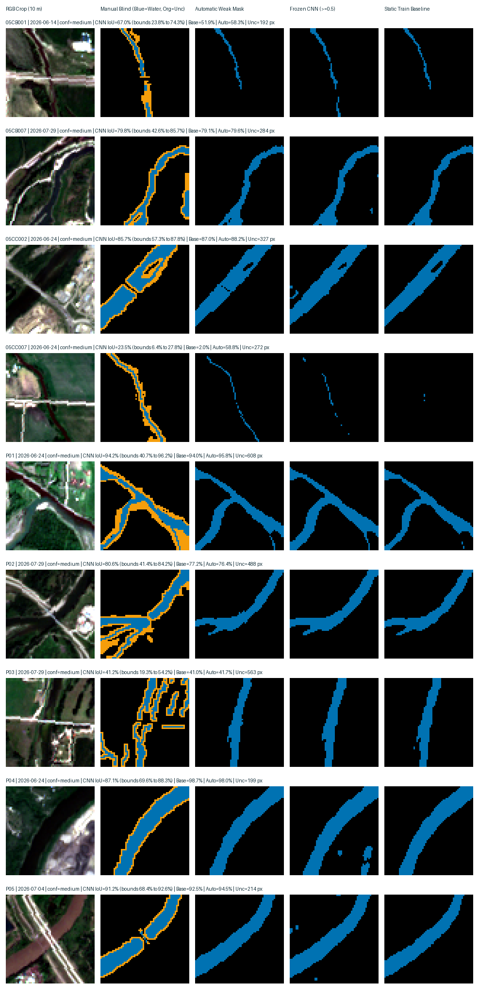

# AIDA 2154 — Supplementary Independent Blind Manual Check (9 Held-Out Sites)

Date: 2026-11-23  
Annotator: Miles (Renjun) Zhang (single-annotator blind check)  
Related instructor guidance: Formative Feedback 1 (2026-11-23)

## 1. Boundary and Relationship to the Original Evaluation

This document records a **strictly separate supplementary evaluation** conducted after the frozen 132-image automatic-label evaluation (`IoU 85.21%` CNN vs. `84.41%` static baseline) was closed and archived.

- **Does not alter or replace the original evaluation:** The frozen model weights, 708/169/132 date-grouped split, 132-image automatic-mask metrics, indirect transect-width failure evidence, and **WITHHOLD** disposition in [`cv-width-failure-report.md`](cv-width-failure-report.md) remain unchanged.
- **Why this supplementary check was added:** Formative Feedback 1 noted that the 132 held-out images measured agreement with automatically generated weak labels rather than independent ground truth, and suggested that a small, carefully documented manual check—kept independent of development choices—would strengthen the fitness-for-purpose analysis.
- **Outcome:** The blind manual check **reinforces** the original **WITHHOLD** recommendation. On independent clear pixels, the frozen CNN (`79.26%` IoU) scored slightly **below** the trivial static training-mask baseline (`79.80%` IoU) and exhibited a **38.5 percentage-point uncertainty interval (`44.83%–83.31%`)** due to mixed 10 m riverbank pixels.

---

## 2. Independent Selection Protocol (Predeclared & Blind)

To prevent cherry-picking or leakage from earlier visual inspection or model error patterns, the sample selection rule was fixed programmatically before any image was viewed (`courses/AIDA-2154/src/cv_tools/independent_manual_eval.py`):

1. **Selection rule:** Exactly **one image per site** across all nine target sites (`05CB001`, `05CB007`, `05CC002`, `05CC007`, `P01–P05`), chosen strictly as the **chronological median** held-out test sample (`items[len(items) // 2]`).
2. **Disjoint from prior visual reviews:** All nine selected dates fall in **June–July 2026**, completely disjoint from `test_examples.png` (first test date per site, `2025-10-22`) and `selection_review.png` (earliest/latest scenes).
3. **Blind annotation environment:** The offline HTML tool embedded only stretched 10 m **RGB** and **NIR–Green–Red** false-color crops (`61 × 61` pixels). **Zero CNN predictions, zero automatic weak masks, zero static baselines, and zero model error metrics** were loaded or displayed during annotation.
4. **Input integrity:** Every annotated crop was verified against its predeclared SHA-256 hash (`blind_selection_manifest.json`) before scoring.

---

## 3. Annotation Method and Uncertainty Protocol

Each `61 × 61` crop (`3,721` pixels; `610 m × 610 m` at native 10 m resolution) was labeled into three explicit classes:

- **`0` — Clear Land / Dry / Non-Water**
- **`1` — Clear Open Water** (visually unambiguous channel water confirmed across RGB + NIR–Green–Red)
- **`2` — Uncertain / Mixed Bank / Bridge / Shadow** (pixels where 10 m mixed reflectance, riparian vegetation overhang, shallow gravel bars, bridge decks, or bank shadows prevented confident binary separation)

**Practical workflow and documented limitation:**

- After tracing clear water (`class 1`) pixel-by-pixel with RGB and NIR reference views, the annotator applied a deterministic **1-pixel 8-connected boundary ring** (`class 2`, uncertain) around traced clear-water pixels to represent minimum 10 m mixed-pixel bank ambiguity, and then manually adjusted extra uncertain zones (braided bars, bridges, dark shadows) and single-pixel erasures where needed.
- Because the 1-pixel uncertainty ring is an explicit protocol choice made by a **single annotator** (not field-surveyed ground truth or multi-rater consensus), this check is an **independent visual audit with explicit uncertainty bounds**, not physical river-width ground truth. No inter-rater reliability score exists.
- All nine crops were rated `confidence = medium`, reflecting persistent 10 m boundary ambiguity even in clear summer imagery.

---

## 4. Quantitative Results (Strictly Separate from 132-Image Weak-Label Eval)

Audit artifacts saved under [`../outputs/independent_manual_eval_20261123/`](../outputs/independent_manual_eval_20261123/):

- `blind_selection_manifest.json` (predeclared median-date selection & crop SHA-256 hashes)
- `manual_blind_annotations_9sites.json` (SHA-256: `e36fdfadfd155fb5024aa26726f365066be6aa94d113867f4d9a0497902d11fe`)
- `manual_eval_summary.json` & `manual_eval_per_site.csv`
- `independent_manual_comparison.png` (side-by-side 9 × 5 visual comparison sheet)

### 4.1 Pooled Metrics Across All 9 Blind Crops (`33,489` Total Pixels)

| Comparison | Evaluated Pixels | TP | FP | FN | TN | IoU | Precision | Recall |
|---|---:|---:|---:|---:|---:|---:|---:|---:|
| **Frozen CNN vs. Manual (Clear Pixels Only)** | 30,342 | 3,248 | 288 | 562 | 26,244 | **79.26%** | 91.86% | 85.25% |
| **Static Train Baseline vs. Manual (Clear Pixels Only)** | 30,342 | 3,144 | 130 | 666 | 26,402 | **79.80%** | 96.03% | 82.52% |
| **Automatic Weak Mask vs. Manual (Clear Pixels Only)** | 30,342 | 3,233 | 124 | 577 | 26,408 | **82.18%** | 96.31% | 84.86% |
| **CNN Uncertainty Lower Bound (All Uncertain = Error)** | 33,489 | 3,248 | 1,283 | 2,714 | 26,244 | **44.83%** | 71.68% | 54.48% |
| **CNN Uncertainty Upper Bound (All Uncertain = Match)** | 33,489 | 4,243 | 288 | 562 | 28,396 | **83.31%** | 93.64% | 88.30% |

**Manual pixel totals:** `3,810` clear water pixels (`11.38%`), `3,147` uncertain/mixed pixels (`9.40%` of all pixels; **`45.24%`** of the `6,957`-pixel combined water + uncertain channel zone), and `26,532` clear land pixels (`79.23%`).

### 4.2 Per-Site Breakdown

| Site | Test Date (UTC) | Clear Water (px) | Uncertain (px) | Uncertain % of Channel Zone | CNN IoU (Clear) | CNN IoU Uncertainty Bounds | Static Baseline IoU (Clear) | Auto Weak Mask IoU (Clear) |
|---|---|---:|---:|---:|---:|---:|---:|---:|
| `05CB001` | 2026-06-14 | 101 | 192 | 65.53% | 66.98% | 23.83% – 74.26% | 51.92% | 58.25% |
| `05CB007` | 2026-07-29 | 321 | 284 | 46.94% | 79.75% | 42.62% – 85.65% | 79.14% | 79.63% |
| `05CC002` | 2026-06-24 | 618 | 327 | 34.60% | 85.74% | 57.30% – 87.84% | 86.97% | 88.15% |
| `05CC007` | 2026-06-24 | 102 | 272 | **72.73%** | **23.53%** | **6.42% – 27.78%** | **1.96%** | 58.82% |
| `P01` | 2026-06-24 | 446 | 608 | 57.69% | 94.17% | 40.71% – 96.25% | 93.97% | 95.83% |
| `P02` | 2026-07-29 | 501 | 488 | 49.34% | 80.58% | 41.38% – 84.20% | 77.19% | 76.37% |
| `P03` | 2026-07-29 | 438 | 563 | 56.24% | **41.25%** | **19.34% – 54.16%** | **41.04%** | 41.67% |
| `P04` | 2026-06-24 | 696 | 199 | 22.23% | **87.09%** | 69.57% – 88.28% | **98.71%** | 97.99% |
| `P05` | 2026-07-04 | 587 | 214 | 26.72% | 91.25% | 68.38% – 92.59% | 92.47% | 94.48% |



---

## 5. Key Diagnostic Findings

1. **The apparent CNN gain on weak labels disappears under independent blind review:** On the original 132-image weak-label test, the CNN appeared `+0.80` percentage points ahead of the static baseline (`85.21%` vs. `84.41%`). On the nine independent blind crops, the CNN scores **−0.54 percentage points below** the static baseline (`79.26%` vs. `79.80%`) and **−2.92 percentage points below** the automatic mask (`82.18%`).
2. **Severe narrow-channel recall collapse (`05CC007`, `05CB001`):** At `05CC007`, `72.73%` of the channel zone is mixed/uncertain at 10 m resolution; the static baseline detects only `2 / 102` clear water pixels (`IoU 1.96%`), and the frozen CNN detects only `24 / 102` fragmented pixels (`IoU 23.53%`, bounds `6.42%–27.78%`). This visually explains the five zero-width predictions during positive flow reported in [`cv-width-failure-report.md`](cv-width-failure-report.md).
3. **Braided side-channel omission (`P03`):** At `P03`, blind visual inspection identifies active side channels / wet oxbow branches alongside the mainstem, whereas the automatic weak mask, static baseline, and CNN all omit the eastern channels (`IoU 41.04%–41.67%`), proving that the CNN inherited the systematic blind spots of its automatic training masks.
4. **Off-channel false positives on wide reaches (`P04`, `P05`):** At `P04`, the CNN predicts `94` false-positive water pixels in dark off-channel terrain/shadow compared to only `1` false positive for the static baseline, dropping CNN IoU (`87.09%`) **11.62 percentage points below** the static baseline (`98.71%`). A similar stray-pixel penalty appears at `P05` (`FP = 53`, CNN `91.25%` vs. baseline `92.47%`).
5. **Dominant 10 m boundary uncertainty:** Across all nine summer scenes, `3,147` pixels are marked uncertain compared to `3,810` clear water pixels (`45.24%` of the channel zone). Even if the CNN were scored generously on every single ambiguous pixel, its upper bound (`83.31%`) cannot eliminate the `44.83%` lower bound—confirming that 10 m optical pixels cannot support reliable bank-to-bank width validation.

---

## 6. Reproducibility Command

To verify all numbers and regenerate the comparison sheet from the frozen model outputs and saved blind annotations (read-only against all original 132-image files):

```powershell
python -B -m cv_tools.independent_manual_eval --score courses/AIDA-2154/outputs/independent_manual_eval_20261123/manual_blind_annotations_9sites.json
```

**Disposition unchanged:** **WITHHOLD** all CV masks and derived widths from downstream hydrological modeling and operational decisions.
