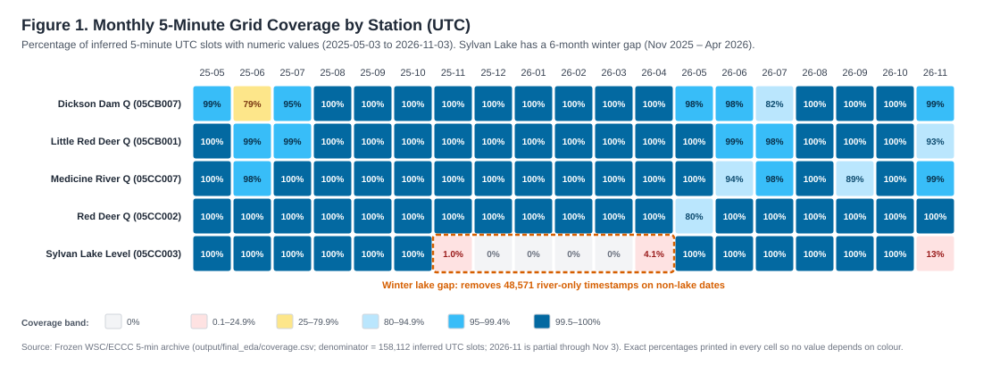
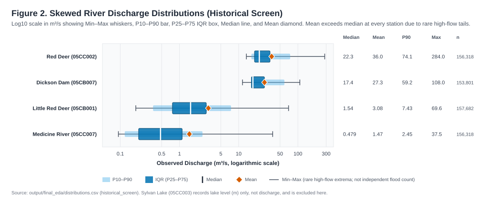
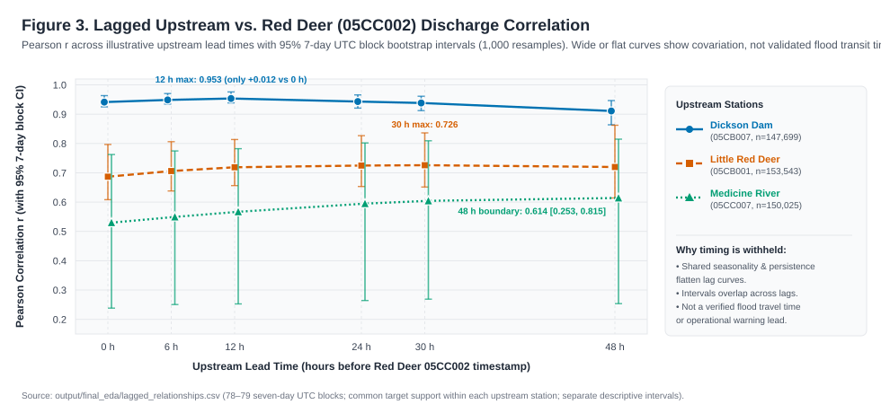
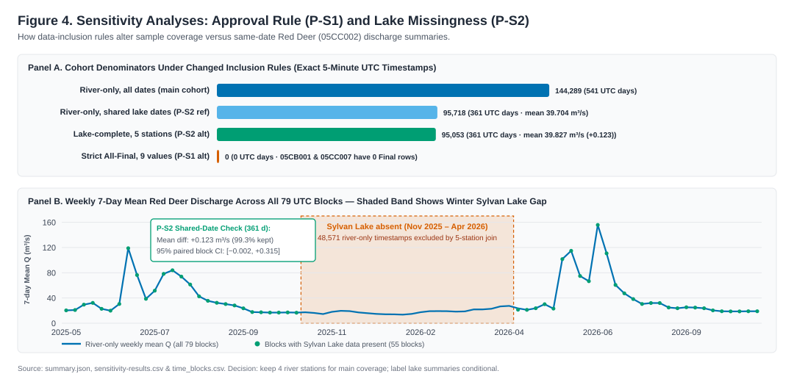

# Which historical observations support a Red Deer River comparison?

**Decision: release this bounded, descriptive study for course review only. Withhold flood warnings, arrival forecasts, intermediate depth estimates as observed facts, and any safety or infrastructure operating decision.**

## Decision and data

A municipal river-infrastructure analyst wants to know which frozen historical observations can support exploratory comparison from Dickson Dam to the Red Deer gauge (05CC002). The population is the available archive, not all hydrological conditions. The exact requested interval is 2025-05-03 07:04:14 through 2026-11-03 07:04:14 UTC. The source and units are in [provenance](../data/provenance.txt) and the [data dictionary](../data/data-dictionary.csv).

The individual observation is station, UTC timestamp and parameter. The four river stations supply discharge (m³/s) and recorded gauge stage (m); Sylvan Lake supplies only a level (m), not a discharge. A joint row is an exact eligible UTC time key shared by all required series, not an event. Coverage uses inferred five-minute slots on the common requested UTC window, checked against the modal cadence at all five stations. The number of missing grid slots does not measure confirmed sensor downtime. The archive has no trustworthy historical availability-at-issue timeline.

## Coverage, distributions and unusual cases

Red Deer recorded **156,318 of 158,112** possible discharge slots (98.9%). Its median discharge was **22.3 m³/s**, the 90th percentile was **74.1 m³/s**, and its maximum was **284.0 m³/s** under the historical screen. These upper values and the mean (36.0 m³/s) show why the median is a better description of typical conditions than the mean alone. Sylvan Lake level covered **105,790 of 158,112 slots (66.9%)**, so requiring it changes the historical evidence base even though the river series are relatively complete.

| Station and parameter | Numeric grid records | Coverage | Median | 90th percentile |
| --- | ---: | ---: | ---: | ---: |
| Dickson discharge (m³/s) | 153,801 | 97.3% | 17.4 | 59.2 |
| Little Red Deer discharge (m³/s) | 157,682 | 99.7% | 1.540 | 7.43 |
| Medicine discharge (m³/s) | 156,318 | 98.9% | 0.479 | 2.45 |
| Red Deer discharge (m³/s) | 156,318 | 98.9% | 22.3 | 74.1 |
| Sylvan Lake level (m) | 105,790 | 66.9% | 936.222 | 936.359 |

The [coverage](../output/final_eda/coverage.csv) table separates numeric, missing, off-grid and excluded values by station, parameter and UTC month. The [quality table](../output/final_eda/quality_counts.csv) keeps grade, approval, symbol and qualifier visibly separate. The [distributions](../output/final_eda/distributions.csv) show counts, percentiles, means and extrema; extrema are not independent events or a verified flood catalogue. The [source-context audit](source-context.md) explains additional weather, Sentinel-2 and GIS limitations.

## Lagged upstream/downstream comparison

For each upstream station, compare discharge with Red Deer discharge at 0, 6, 12, 24, 30 and 48 hours of upstream lead. Within each station, use the same set of exact endpoint times for every lag; supports may differ across stations. Pearson correlation is unitless and depends on the agreement of flow levels, not agreement on the onset, crest or magnitude of an individual flood.

| Upstream station | Common target rows | Seven-day blocks | Correlation at 0 h | Largest among tested lags (95% block interval) |
| --- | ---: | ---: | ---: | --- |
| Dickson (05CB007) | 147,699 | 78 | 0.941 | 12 h: 0.953 [0.939, 0.976] |
| Little Red Deer (05CB001) | 153,543 | 79 | 0.687 | 30 h: 0.726 [0.651, 0.836] |
| Medicine (05CC007) | 150,025 | 79 | 0.530 | 48 h: 0.614 [0.253, 0.815] |

The largest Dickson coefficient was only 0.012 above its same-time coefficient. Medicine's largest value occurred at the grid boundary and had a wide interval. The data describe broad covariation; they do not resolve the difference between adjacent lags or explain individual timing errors. All 18 values are in the [lag table](../output/final_eda/lagged_relationships.csv).

The 95% percentile intervals use 1,000 resamples of seven-day UTC blocks, preserving within-week observations rather than treating every five-minute row as independent. The endpoints describe conditional historical variability, not independent-event uncertainty; adjacent weeks may still depend on one another. These are separate descriptive intervals, not a simultaneous comparison across the lag grid. Seasonal flow, shared inputs, persistence and sample selection can all contribute. Do not infer transit time from the largest correlation or use it as a lead time.

## What changed under two different data rules?

The historical screen accepts numeric positive measurements with blank symbol and qualifier fields; off-grid values are not matched. It retains numeric grades and provisional approvals for inspection rather than assuming grade codes form an ordinal score. Approval labels and condition codes are distinct (see [Water Office guidance](https://wateroffice.ec.gc.ca/contactus/faq_e.html)). Missing observations are not substituted. Both comparisons keep the same frozen archive and endpoint discharge.

| Test | Change and count | Endpoint result | Decision effect |
| --- | --- | --- | --- |
| P-S1: stricter approval | Require explicit `Final/Finales` on all nine values, beyond the existing screen. Joint lake-complete rows fall from **95,053 to 0**. No eligible final stage or discharge was available from Little Red Deer or Medicine. | The baseline joint mean is 39.827 m³/s. No all-final mean or interval can be estimated; missing estimates are not zeros. | Joint comparison can only be exploratory using observations that may be provisional. Approval filtering changes eligibility, not proof of data error. |
| P-S2: lake missingness | 144,289 eligible river-only rows across all dates, of which 95,718 are on the 361 UTC dates represented in the lake-complete cohort. Lake completeness retains **95,053 of 95,718 (99.3%)** within those dates. | Endpoint mean **39.704 to 39.827 m³/s**; difference **+0.123 m³/s** (95% paired block interval **−0.002 to +0.315**). Median 28.8 to 29.0; P90 unchanged at 76.4 m³/s. | Keep the broader cohort for river-only coverage; label lake-dependent summaries as conditional. The modest same-date difference does not undo the loss of **48,571** river-only rows on other dates. |

An endpoint-only check is not a substitute for the empty joint P-S1 set. On 244 shared UTC dates, the Red Deer discharge screen included 70,179 rows; 69,975 remained under final approval. The mean moved from 34.365 to 34.420 m³/s, a difference of +0.055 m³/s (95% paired block interval 0.000 to +0.185); median 21.7 and P90 73.3 were unchanged. The [full summary](../output/final_eda/summary.json) gives exact values.

For the lake comparison, report both the full river-only coverage and the restriction to dates supported by both specifications. Same-day restriction limits season differences but does not equalize the five-minute samples or remove selection. The paired block interval for the difference addresses short-run dependence and does not identify a causal lake effect.

## Limits and evidence needed

1. Use actual observed discharge for further historical event study. Establish an independent event list, longer observation coverage, winter/ice handling and uninspected events before claiming robust onset or crest estimates.
2. Keep lake-dependent summaries separate, with their own coverage. Investigate when and why the lake series is missing before any reuse outside those observed dates.
3. Keep station-relative stage separate from verified depth. A cross-section sensitivity would require an independently checked gauge-to-survey transfer, verified bank/profile elevations and held-out interior measurements. No arbitrary vertical shift was used to produce a depth result.
4. This report does not score the frozen V4. Its final test and separate Windows adapter do not qualify for operational use. Reported observations, reconstructed diagnostics and experimental model outputs must remain distinguishable.

Read the [claim-to-evidence index](../claim-evidence-index.csv) to trace each decision, and the [accessibility notes](accessibility-notes.md) for table and text alternatives.
